# Praktikum 5 – Pengenalan JavaScript (Pemrograman Web)

| | |
|---|---|
| **Nama** | Riksa Siddiq Alrizki |
| **NIM** | 312510015 |
| **Kelas** | I253D |
| **Program Studi** | Teknik Informatika |
| **Mata Kuliah** | Pemrograman Web |
| **Universitas** | Universitas Pelita Bangsa |

---

## 1. Tujuan Praktikum

1. Mengenali cara menampilkan output JavaScript pada halaman web dan Console.
2. Menggunakan `alert` dan `prompt` untuk interaksi sederhana dengan pengguna.
3. Membuat function dan memakai operator aritmetika.
4. Menggunakan seleksi kondisi `if-else` dan `switch`.
5. Memanipulasi DOM dan menangani event (`onclick`, `change`).
6. Membuat program kalkulator nilai mahasiswa sebagai mini project.

## 2. Struktur Folder

```
Lab5Web/
├── index.html      (struktur halaman)
├── script.js       (kode JavaScript)
├── screenshoot/    (1.png - 15.png)
└── README.md
```

Script dihubungkan ke HTML dengan tag berikut, yang diletakkan menjelang akhir `body` agar seluruh elemen HTML sudah tersedia saat script dijalankan.

```html
<script src="script.js"></script>
```

---

## 3. Latihan

### Latihan 1 – Menampilkan output

**Tujuan:** mengenali cara menampilkan output di halaman dan Console.

```javascript
document.getElementById("pesan").textContent = "Hello World";
console.log("Hello World");
```

**Penjelasan:**

- `document.getElementById("pesan").textContent = ...` mengubah isi teks elemen ber-ID `pesan` pada halaman.
- `console.log(...)` menampilkan pesan di Console browser (developer tools), tidak di halaman.

**Hasil:** teks "Hello World" tampil di bawah judul "Pengenalan JavaScript".

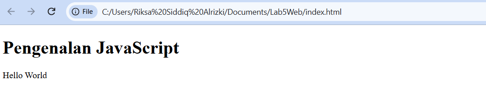

**Perbedaan output:** output pada halaman dapat dilihat oleh pengguna, sedangkan output pada Console hanya terlihat oleh pengembang dan biasanya dipakai untuk pengujian (*debugging*).

---

### Latihan 2 – Alert dan prompt

```javascript
const namaPengguna = prompt("Masukkan nama Anda:", "");
if (namaPengguna && namaPengguna.trim() !== "") {
  alert("Halo, " + namaPengguna + "!");
  document.getElementById("pesan").textContent = "Selamat datang, " + namaPengguna + ".";
} else {
  alert("Nama belum diisi.");
}
```

**Penjelasan:**

- `prompt()` menampilkan kotak dialog input dan mengembalikan teks yang diketik (atau `null` jika menekan Cancel).
- Kondisi `namaPengguna && namaPengguna.trim() !== ""` memastikan nama tidak `null` dan tidak kosong.
- Jika valid, ditampilkan `alert` sapaan dan teks halaman diganti. Jika tidak, ditampilkan pesan "Nama belum diisi.".

**Pengujian:**

| Skenario | Perilaku program | Bukti |
|---|---|---|
| Nama diisi, tekan OK | Muncul alert sapaan dan teks halaman berubah menjadi "Selamat datang, ..." | Gambar 2 dan 3 |
| Cancel / input kosong | Muncul alert "Nama belum diisi." | Gambar 4 |

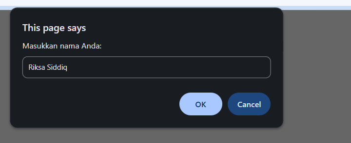

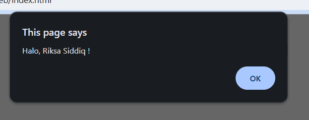

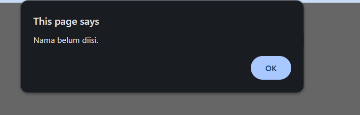

---

### Latihan 3 – Function dan operasi aritmetika

```javascript
function operasiDasar(a, b) {
  console.log("Penjumlahan:", a + b);
  console.log("Pengurangan:", a - b);
  console.log("Perkalian:", a * b);
  console.log("Pembagian:", b !== 0 ? a / b : "Tidak dapat dibagi nol");
  console.log("Modulus:", a % b);
}
operasiDasar(9, 4);
```

**Penjelasan:** function `operasiDasar` menerima dua parameter dan menampilkan lima hasil operasi. Pada pembagian dipakai operator ternary `b !== 0 ? ... : ...` agar pembagian dengan nol tidak menghasilkan `Infinity`.

**Hasil di Console untuk `operasiDasar(9, 4)`:**

| Operasi | Perhitungan | Hasil |
|---|---|---|
| Penjumlahan | 9 + 4 | 13 |
| Pengurangan | 9 − 4 | 5 |
| Perkalian | 9 × 4 | 36 |
| Pembagian | 9 / 4 | 2.25 |
| Modulus (sisa bagi) | 9 % 4 | 1 |

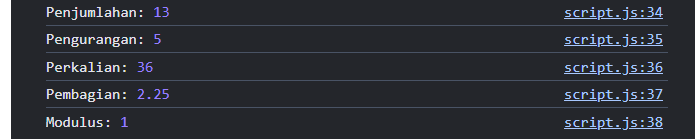

---

### Latihan 4 – Seleksi kondisi if–else

```javascript
const inputNilai = prompt("Masukkan nilai (0–100):");
const nilaiMahasiswa = Number(inputNilai);

if (inputNilai === null || inputNilai.trim() === "" ||
    Number.isNaN(nilaiMahasiswa) || nilaiMahasiswa < 0 || nilaiMahasiswa > 100) {
  alert("Input nilai tidak valid.");
} else if (nilaiMahasiswa >= 60) {
  alert("Lulus");
} else {
  alert("Belum lulus");
}
```

**Penjelasan:**

- `prompt` selalu menghasilkan string, sehingga nilai dikonversi dengan `Number()` sebelum dibandingkan.
- Kondisi pertama memeriksa validitas input (bukan `null`, tidak kosong, berupa angka, dan berada di rentang 0–100).
- Jika valid, nilai ≥ 60 dinyatakan **Lulus**, selain itu **Belum lulus**.

**Hasil:** pada pengujian ini nilai yang dimasukkan berada di bawah 60 sehingga muncul alert "Belum lulus".

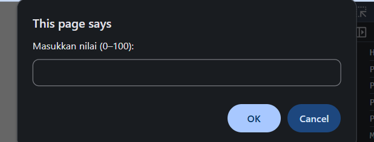

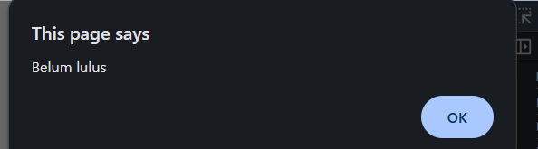

---

### Latihan 5 – Seleksi kondisi switch

```javascript
const inputPilihan = prompt("Masukkan angka 1–5:");
switch (inputPilihan) {
  case "1": alert("Bilangan satu"); break;
  case "2": alert("Bilangan dua"); break;
  case "3": alert("Bilangan tiga"); break;
  case "4": alert("Bilangan empat"); break;
  case "5": alert("Bilangan lima"); break;
  default: alert("Pilihan tidak tersedia");
}
```

**Penjelasan:** `switch` membandingkan nilai `inputPilihan` dengan tiap `case`. Karena `prompt` menghasilkan string, nilai `case` ditulis sebagai string (`"1"`, `"2"`, dst.). `break` menghentikan eksekusi setelah `case` yang cocok, dan `default` dijalankan jika tidak ada yang cocok.

**Hasil:** input angka 3 menampilkan alert "Bilangan tiga".

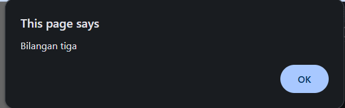

---

### Latihan 6 – Form bilangan genap atau ganjil

```html
<label for="bilangan">Masukkan bilangan bulat:</label>
<input type="number" id="bilangan" step="1">
<button type="button" onclick="cekBilangan()">Periksa</button>
<p id="hasilBilangan"></p>
```

```javascript
function cekBilangan() {
  const input = document.getElementById("bilangan").value;
  const angka = Number(input);
  const hasil = document.getElementById("hasilBilangan");

  if (input.trim() === "" || !Number.isInteger(angka)) {
    hasil.textContent = "Masukkan bilangan bulat yang valid.";
  } else if (angka % 2 === 0) {
    hasil.textContent = "Bilangan genap";
  } else {
    hasil.textContent = "Bilangan ganjil";
  }
}
```

**Penjelasan:**

- Tombol **Periksa** memanggil function `cekBilangan()` lewat atribut `onclick`.
- Function mengambil nilai input, mengubahnya menjadi angka, lalu memeriksa: kosong atau bukan bilangan bulat → pesan kesalahan; sisa bagi 2 sama dengan 0 → genap; selain itu → ganjil.
- Hasil ditampilkan pada elemen `<p id="hasilBilangan">`.

**Hasil:** input `4` menampilkan "Bilangan genap".

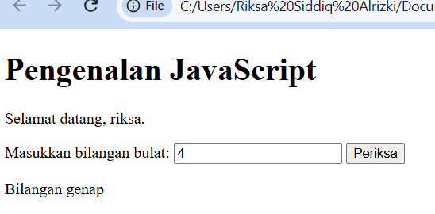

---

### Latihan 7 – Mengubah warna halaman

```javascript
function ubahWarnaLatar(warna) {
  document.body.style.backgroundColor = warna;
}
```

```html
<button type="button" onclick="ubahWarnaLatar('lightgreen')">Latar Hijau</button>
<button type="button" onclick="ubahWarnaLatar('white')">Latar Putih</button>
<button type="button" onclick="ubahWarnaLatar('lightyellow')">Latar Kuning</button>
```

**Penjelasan:** satu function dengan parameter `warna` dipakai oleh ketiga tombol sehingga kode tidak berulang. Function mengubah properti `style.backgroundColor` pada `document.body`.

**Hasil:** tiga tombol tampil di halaman, dan setelah **Latar Hijau** ditekan, latar halaman berubah menjadi hijau muda.

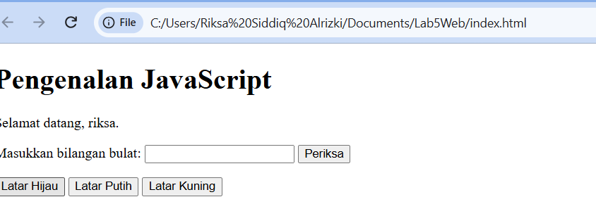

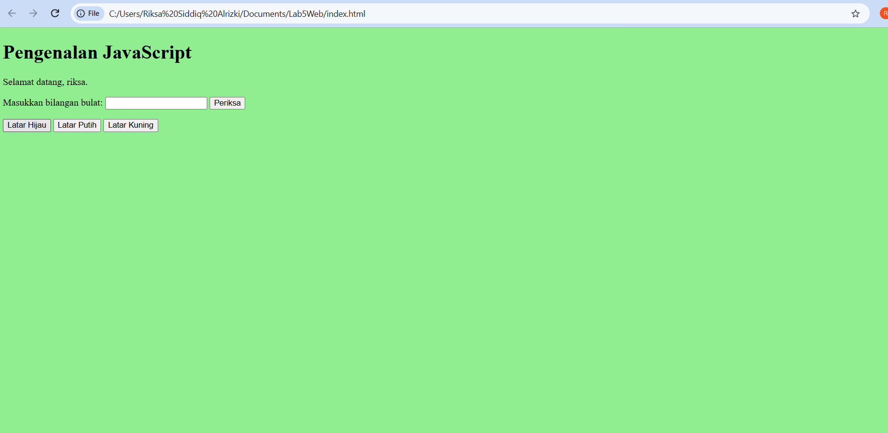

---

### Latihan 8 – DOM dan checkbox menu makanan

```html
<h3>Daftar Menu Makanan</h3>
<label><input type="checkbox" class="menu" value="5000"> Ayam Goreng — Rp5.000</label><br>
<label><input type="checkbox" class="menu" value="500"> Tempe — Rp500</label><br>
<label><input type="checkbox" class="menu" value="2500"> Telur Dadar — Rp2.500</label><br>
<p>Total: Rp<span id="total">0</span></p>
```

```javascript
const daftarMenu = document.querySelectorAll(".menu");
daftarMenu.forEach((item) => {
  item.addEventListener("change", hitungTotal);
});

function hitungTotal() {
  let total = 0;
  daftarMenu.forEach((item) => {
    if (item.checked) total += Number(item.value);
  });
  document.getElementById("total").textContent = total.toLocaleString("id-ID");
}
```

**Penjelasan:**

- `querySelectorAll(".menu")` mengambil semua checkbox ber-class `menu`.
- `addEventListener("change", hitungTotal)` menjalankan `hitungTotal` setiap kali sebuah checkbox dicentang atau dilepas.
- `hitungTotal` menjumlahkan `value` dari checkbox yang `checked`, lalu menampilkan hasilnya pada `<span id="total">` dengan format angka Indonesia (`toLocaleString("id-ID")`, misalnya 8.000).

**Hasil:** ketika ketiga menu dicentang, total yang tampil adalah Rp8.000 (5.000 + 500 + 2.500).

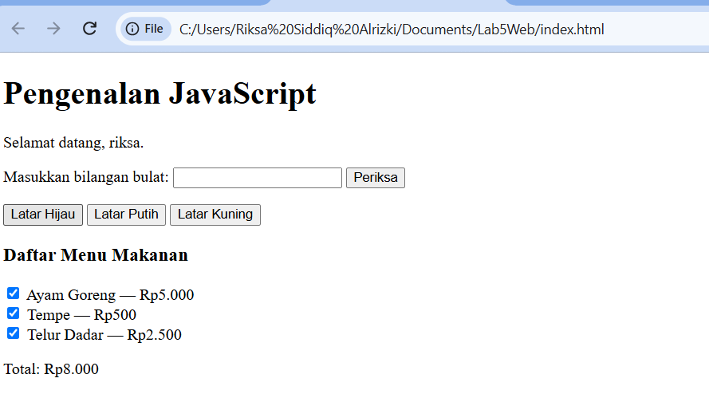

---

## 4. Mini Project – Kalkulator Nilai Mahasiswa

Program menerima nilai tugas, UTS, dan UAS melalui form, lalu menghitung nilai akhir, predikat, dan status kelulusan yang ditampilkan di halaman HTML.

**Ketentuan perhitungan (sesuai modul):**

```javascript
function hitungNilaiAkhir(tugas, uts, uas) {
  return tugas * 0.30 + uts * 0.30 + uas * 0.40;
}

function tentukanPredikat(nilai) {
  if (nilai >= 85) return "A";
  if (nilai >= 75) return "B";
  if (nilai >= 60) return "C";
  if (nilai >= 50) return "D";
  return "E";
}
```

| Komponen | Bobot |
|---|---|
| Nilai Tugas | 30% |
| Nilai UTS | 30% |
| Nilai UAS | 40% |

| Nilai akhir | Predikat |
|---|---|
| ≥ 85 | A |
| 75 – 84 | B |
| 60 – 74 | C |
| 50 – 59 | D |
| < 50 | E |

Status kelulusan: **Lulus** jika nilai akhir ≥ 60, selain itu **Belum Lulus**. Function perhitungan dipisahkan dari bagian yang menampilkan hasil ke halaman.

### Pengujian dengan tiga skenario

| No | Tugas | UTS | UAS | Perhitungan | Nilai akhir | Predikat | Status |
|---|---|---|---|---|---|---|---|
| 1 | 90 | 95 | 80 | 27 + 28,5 + 32 | 87,50 | A | Lulus |
| 2 | 50 | 50 | 50 | 15 + 15 + 20 | 50,00 | D | Belum Lulus |
| 3 | 50 | 70 | 100 | 15 + 21 + 40 | 76,00 | B | Lulus |

**Skenario 1** – nilai tinggi menghasilkan predikat A dan status Lulus (kotak hasil berwarna hijau):

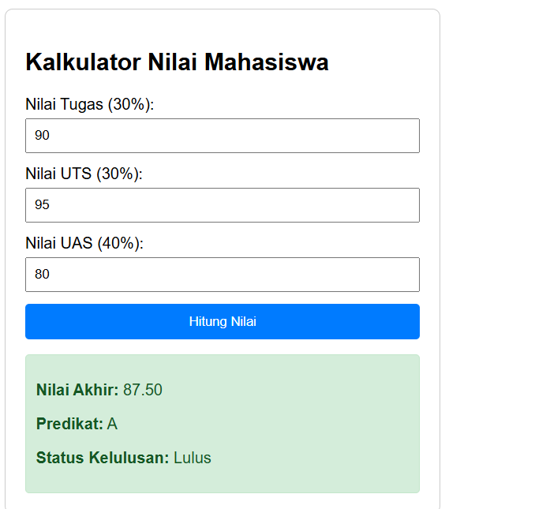

**Skenario 2** – nilai akhir 50 berada di bawah batas kelulusan 60 sehingga predikat D dan status Belum Lulus (kotak hasil berwarna merah):

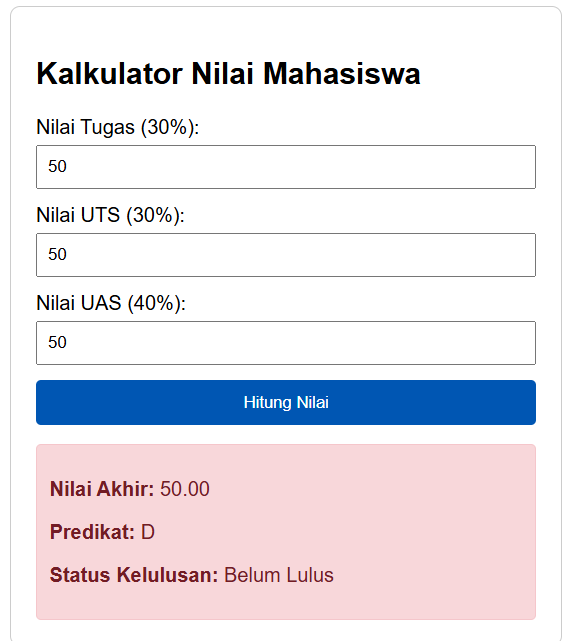

**Skenario 3** – nilai tugas rendah tetapi nilai UAS tinggi menghasilkan nilai akhir 76,00 dengan predikat B dan status Lulus:

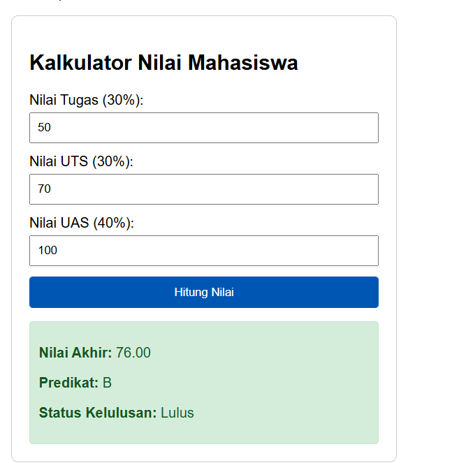

Hasil perhitungan program pada ketiga skenario sesuai dengan perhitungan manual pada tabel.

---

## 5. Kesimpulan

Pada praktikum ini dipelajari dasar-dasar JavaScript: menampilkan output di halaman dan Console, berinteraksi dengan pengguna melalui `alert` dan `prompt`, membuat function, serta menggunakan seleksi kondisi `if-else` dan `switch`. Disadari bahwa `prompt` dan nilai input form selalu bertipe string sehingga perlu dikonversi dengan `Number()` dan divalidasi sebelum dihitung. Selain itu dipelajari manipulasi DOM (`getElementById`, `querySelectorAll`, `textContent`, `style`) dan penanganan event (`onclick` dan `addEventListener`). Mini project kalkulator nilai mahasiswa menunjukkan bagaimana function, kondisi, dan DOM digabungkan menjadi program yang menampilkan hasil perhitungan pada halaman web.
