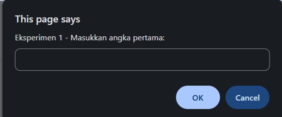
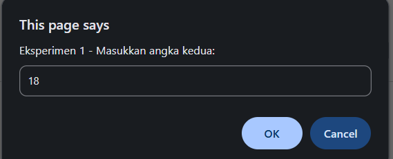
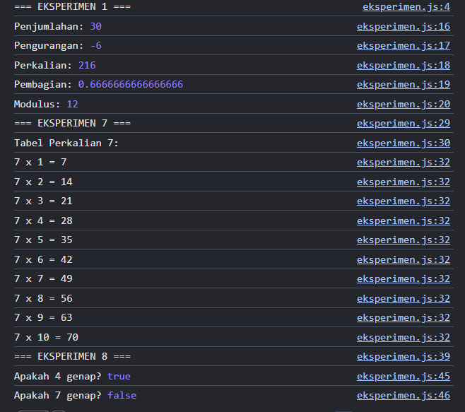
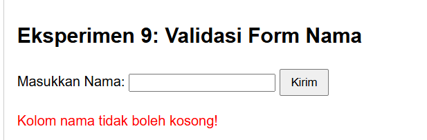
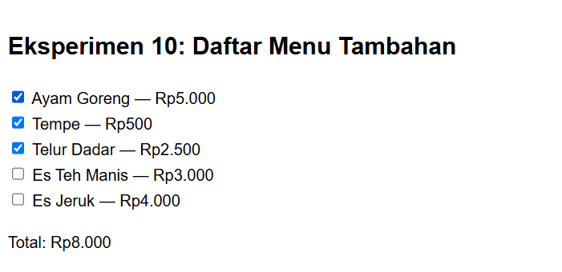
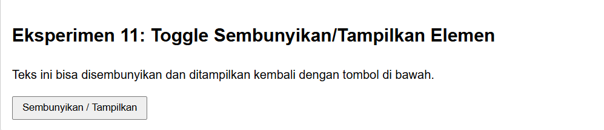

# Praktikum 5 – Pengenalan JavaScript (Pemrograman Web)

| | |
|---|---|
| **Nama** | Riksa Siddiq Alrizki |
| **NIM** | 312510015 |
| **Kelas** | I253A |
| **Program Studi** | Teknik Informatika |
| **Mata Kuliah** | Pemrograman Web |
| **Universitas** | Universitas Pelita Bangsa |


# Pertanyaan dan Tugas

## 1. Perbedaan Output dan Interaksi JavaScript

### `console.log()`
- Menampilkan data atau pesan ke **Console** pada browser (`Inspect → Console`).
- Digunakan untuk proses **debugging** tanpa mengganggu tampilan pengguna.

### `alert()`
- Menampilkan kotak dialog peringatan dengan tombol **OK**.
- Menghentikan sementara eksekusi program sampai pengguna menutup dialog.

### `prompt()`
- Menampilkan kotak dialog untuk meminta input dari pengguna.
- Nilai yang dikembalikan bertipe **String** atau `null` jika dibatalkan.

### `textContent` dan `innerHTML`
- **`textContent`** digunakan untuk mengubah isi teks suatu elemen HTML.
- **`innerHTML`** digunakan untuk mengubah isi elemen HTML sekaligus dapat merender tag HTML di dalamnya.

---

## 2. Perbedaan `let` dan `const`

### `let`
- Digunakan untuk mendeklarasikan variabel.
- Nilainya **dapat diubah kembali** (*re-assignable*).

### `const`
- Digunakan untuk mendeklarasikan konstanta.
- Nilainya **tidak dapat diubah kembali** setelah diinisialisasi.

### Contoh

```javascript
// Contoh let
let umur = 20;
umur = 21; // Berhasil diubah

// Contoh const
const nama = "Rani";
// nama = "Budi"; // Error: Assignment to constant variable.
```

---

## 3. Perbedaan Operator `==` dan `===`

### `==` (Loose Equality)
- Membandingkan dua nilai **tanpa memperhatikan tipe data**.
- JavaScript akan melakukan konversi tipe data secara otomatis.

### `===` (Strict Equality)
- Membandingkan dua nilai **beserta tipe datanya**.
- Bernilai `true` hanya jika nilai dan tipe datanya sama.

### Contoh

```javascript
console.log(5 == "5");  // true
console.log(5 === "5"); // false
```

---

## 4. Fungsi `if-else` dan `switch`

### `if-else`
**Fungsi:**
- Menyeleksi kondisi berdasarkan ekspresi boolean (`true` atau `false`).

**Penggunaan:**
- Cocok untuk kondisi yang kompleks.
- Dapat digunakan untuk rentang nilai.
- Mendukung operator logika seperti `&&` dan `||`.

### `switch`
**Fungsi:**
- Menyeleksi satu nilai terhadap beberapa pilihan (`case`).

**Penggunaan:**
- Cocok digunakan jika memiliki banyak pilihan berdasarkan satu nilai tertentu, misalnya menu atau pilihan angka.

---

## 5. Fungsi Parameter dan `return`

### Parameter
- Variabel yang menerima nilai masukan saat fungsi dipanggil.

### `return`
- Digunakan untuk mengembalikan hasil proses dari fungsi kepada pemanggil.

### Contoh

```javascript
function hitungLuas(panjang, lebar) {
    return panjang * lebar;
}
```

---

## 6. Cara `document.getElementById()` Memilih Elemen HTML

Method `document.getElementById()` digunakan untuk mencari dan mengambil **satu elemen HTML** berdasarkan nilai atribut `id`.

### HTML

```html
<p id="pesan">Konten awal.</p>
```

### JavaScript

```javascript
const elemenPesan = document.getElementById("pesan");
elemenPesan.textContent = "Teks Baru";
```

---

## 7. Script Validasi Form (Nama Tidak Kosong & Nilai 0–100)

### HTML

```html
<form id="formMahasiswa">
    <label for="nama">Nama:</label>
    <input type="text" id="nama">

    <label for="nilai">Nilai (0-100):</label>
    <input type="number" id="nilai">

    <button type="button" onclick="validasiForm()">
        Kirim
    </button>
</form>

<p id="pesanError" style="color:red;"></p>
```

### JavaScript

```javascript
function validasiForm() {
    const nama = document.getElementById("nama").value.trim();
    const inputNilai = document.getElementById("nilai").value.trim();
    const nilai = Number(inputNilai);
    const pesanError = document.getElementById("pesanError");

    // Reset pesan error
    pesanError.textContent = "";

    // Validasi nama
    if (nama === "") {
        pesanError.textContent = "Nama tidak boleh kosong!";
        return false;
    }

    // Validasi nilai
    if (
        inputNilai === "" ||
        Number.isNaN(nilai) ||
        nilai < 0 ||
        nilai > 100
    ) {
        pesanError.textContent =
            "Nilai harus berupa angka pada rentang 0–100!";
        return false;
    }

    alert("Validasi berhasil! Data siap diproses.");
    return true;
}
```

### Penjelasan
- Nama tidak boleh kosong.
- Nilai harus berupa angka.
- Nilai harus berada pada rentang **0–100**.
- Jika validasi berhasil, akan muncul pesan:
  ```
  Validasi berhasil! Data siap diproses.
  ```

---

## 1. Tujuan Praktikum

1. Mengenali cara menampilkan output JavaScript pada halaman web dan Console.
2. Menggunakan `alert` dan `prompt` untuk interaksi sederhana dengan pengguna.
3. Membuat function dan memakai operator aritmetika.
4. Menggunakan seleksi kondisi `if-else` dan `switch`.
5. Memanipulasi DOM dan menangani event (`onclick`, `change`).
6. Membuat program kalkulator nilai mahasiswa sebagai mini project.

## 2. Struktur Folder

```
Lab5Web/
├── index.html      (struktur halaman)
├── script.js       (kode JavaScript latihan)
├── eksperimen.html (halaman eksperimen mandiri)
├── eksperimen.js   (kode JavaScript eksperimen mandiri)
├── screenshoot/    (1.png - 21.png)
└── README.md
```

Script dihubungkan ke HTML dengan tag berikut, yang diletakkan menjelang akhir `body` agar seluruh elemen HTML sudah tersedia saat script dijalankan.

```html
<script src="script.js"></script>
```

---

## 3. Latihan

### Latihan 1 – Menampilkan output

**Tujuan:** mengenali cara menampilkan output di halaman dan Console.

```javascript
document.getElementById("pesan").textContent = "Hello World";
console.log("Hello World");
```

**Penjelasan:**

- `document.getElementById("pesan").textContent = ...` mengubah isi teks elemen ber-ID `pesan` pada halaman.
- `console.log(...)` menampilkan pesan di Console browser (developer tools), tidak di halaman.

**Hasil:** teks "Hello World" tampil di bawah judul "Pengenalan JavaScript".


**Perbedaan output:** output pada halaman dapat dilihat oleh pengguna, sedangkan output pada Console hanya terlihat oleh pengembang dan biasanya dipakai untuk pengujian (*debugging*).

---

### Latihan 2 – Alert dan prompt

```javascript
const namaPengguna = prompt("Masukkan nama Anda:", "");
if (namaPengguna && namaPengguna.trim() !== "") {
  alert("Halo, " + namaPengguna + "!");
  document.getElementById("pesan").textContent = "Selamat datang, " + namaPengguna + ".";
} else {
  alert("Nama belum diisi.");
}
```

**Penjelasan:**

- `prompt()` menampilkan kotak dialog input dan mengembalikan teks yang diketik (atau `null` jika menekan Cancel).
- Kondisi `namaPengguna && namaPengguna.trim() !== ""` memastikan nama tidak `null` dan tidak kosong.
- Jika valid, ditampilkan `alert` sapaan dan teks halaman diganti. Jika tidak, ditampilkan pesan "Nama belum diisi.".

**Pengujian:**

| Skenario | Perilaku program | Bukti |
|---|---|---|
| Nama diisi, tekan OK | Muncul alert sapaan dan teks halaman berubah menjadi "Selamat datang, ..." | Gambar 2 dan 3 |
| Cancel / input kosong | Muncul alert "Nama belum diisi." | Gambar 4 |


---

### Latihan 3 – Function dan operasi aritmetika

```javascript
function operasiDasar(a, b) {
  console.log("Penjumlahan:", a + b);
  console.log("Pengurangan:", a - b);
  console.log("Perkalian:", a * b);
  console.log("Pembagian:", b !== 0 ? a / b : "Tidak dapat dibagi nol");
  console.log("Modulus:", a % b);
}
operasiDasar(9, 4);
```

**Penjelasan:** function `operasiDasar` menerima dua parameter dan menampilkan lima hasil operasi. Pada pembagian dipakai operator ternary `b !== 0 ? ... : ...` agar pembagian dengan nol tidak menghasilkan `Infinity`.

**Hasil di Console untuk `operasiDasar(9, 4)`:**

| Operasi | Perhitungan | Hasil |
|---|---|---|
| Penjumlahan | 9 + 4 | 13 |
| Pengurangan | 9 − 4 | 5 |
| Perkalian | 9 × 4 | 36 |
| Pembagian | 9 / 4 | 2.25 |
| Modulus (sisa bagi) | 9 % 4 | 1 |


---

### Latihan 4 – Seleksi kondisi if–else

```javascript
const inputNilai = prompt("Masukkan nilai (0–100):");
const nilaiMahasiswa = Number(inputNilai);

if (inputNilai === null || inputNilai.trim() === "" ||
    Number.isNaN(nilaiMahasiswa) || nilaiMahasiswa < 0 || nilaiMahasiswa > 100) {
  alert("Input nilai tidak valid.");
} else if (nilaiMahasiswa >= 60) {
  alert("Lulus");
} else {
  alert("Belum lulus");
}
```

**Penjelasan:**

- `prompt` selalu menghasilkan string, sehingga nilai dikonversi dengan `Number()` sebelum dibandingkan.
- Kondisi pertama memeriksa validitas input (bukan `null`, tidak kosong, berupa angka, dan berada di rentang 0–100).
- Jika valid, nilai ≥ 60 dinyatakan **Lulus**, selain itu **Belum lulus**.

**Hasil:** pada pengujian ini nilai yang dimasukkan berada di bawah 60 sehingga muncul alert "Belum lulus".


---

### Latihan 5 – Seleksi kondisi switch

```javascript
const inputPilihan = prompt("Masukkan angka 1–5:");
switch (inputPilihan) {
  case "1": alert("Bilangan satu"); break;
  case "2": alert("Bilangan dua"); break;
  case "3": alert("Bilangan tiga"); break;
  case "4": alert("Bilangan empat"); break;
  case "5": alert("Bilangan lima"); break;
  default: alert("Pilihan tidak tersedia");
}
```

**Penjelasan:** `switch` membandingkan nilai `inputPilihan` dengan tiap `case`. Karena `prompt` menghasilkan string, nilai `case` ditulis sebagai string (`"1"`, `"2"`, dst.). `break` menghentikan eksekusi setelah `case` yang cocok, dan `default` dijalankan jika tidak ada yang cocok.

**Hasil:** input angka 3 menampilkan alert "Bilangan tiga".


---

### Latihan 6 – Form bilangan genap atau ganjil

```html
<label for="bilangan">Masukkan bilangan bulat:</label>
<input type="number" id="bilangan" step="1">
<button type="button" onclick="cekBilangan()">Periksa</button>
<p id="hasilBilangan"></p>
```

```javascript
function cekBilangan() {
  const input = document.getElementById("bilangan").value;
  const angka = Number(input);
  const hasil = document.getElementById("hasilBilangan");

  if (input.trim() === "" || !Number.isInteger(angka)) {
    hasil.textContent = "Masukkan bilangan bulat yang valid.";
  } else if (angka % 2 === 0) {
    hasil.textContent = "Bilangan genap";
  } else {
    hasil.textContent = "Bilangan ganjil";
  }
}
```

**Penjelasan:**

- Tombol **Periksa** memanggil function `cekBilangan()` lewat atribut `onclick`.
- Function mengambil nilai input, mengubahnya menjadi angka, lalu memeriksa: kosong atau bukan bilangan bulat → pesan kesalahan; sisa bagi 2 sama dengan 0 → genap; selain itu → ganjil.
- Hasil ditampilkan pada elemen `<p id="hasilBilangan">`.

**Hasil:** input `4` menampilkan "Bilangan genap".


---

### Latihan 7 – Mengubah warna halaman

```javascript
function ubahWarnaLatar(warna) {
  document.body.style.backgroundColor = warna;
}
```

```html
<button type="button" onclick="ubahWarnaLatar('lightgreen')">Latar Hijau</button>
<button type="button" onclick="ubahWarnaLatar('white')">Latar Putih</button>
<button type="button" onclick="ubahWarnaLatar('lightyellow')">Latar Kuning</button>
```

**Penjelasan:** satu function dengan parameter `warna` dipakai oleh ketiga tombol sehingga kode tidak berulang. Function mengubah properti `style.backgroundColor` pada `document.body`.

**Hasil:** tiga tombol tampil di halaman, dan setelah **Latar Hijau** ditekan, latar halaman berubah menjadi hijau muda.


---

### Latihan 8 – DOM dan checkbox menu makanan

```html
<h3>Daftar Menu Makanan</h3>
<label><input type="checkbox" class="menu" value="5000"> Ayam Goreng — Rp5.000</label><br>
<label><input type="checkbox" class="menu" value="500"> Tempe — Rp500</label><br>
<label><input type="checkbox" class="menu" value="2500"> Telur Dadar — Rp2.500</label><br>
<p>Total: Rp<span id="total">0</span></p>
```

```javascript
const daftarMenu = document.querySelectorAll(".menu");
daftarMenu.forEach((item) => {
  item.addEventListener("change", hitungTotal);
});

function hitungTotal() {
  let total = 0;
  daftarMenu.forEach((item) => {
    if (item.checked) total += Number(item.value);
  });
  document.getElementById("total").textContent = total.toLocaleString("id-ID");
}
```

**Penjelasan:**

- `querySelectorAll(".menu")` mengambil semua checkbox ber-class `menu`.
- `addEventListener("change", hitungTotal)` menjalankan `hitungTotal` setiap kali sebuah checkbox dicentang atau dilepas.
- `hitungTotal` menjumlahkan `value` dari checkbox yang `checked`, lalu menampilkan hasilnya pada `<span id="total">` dengan format angka Indonesia (`toLocaleString("id-ID")`, misalnya 8.000).

**Hasil:** ketika ketiga menu dicentang, total yang tampil adalah Rp8.000 (5.000 + 500 + 2.500).


---

## 4. Mini Project – Kalkulator Nilai Mahasiswa

Program menerima nilai tugas, UTS, dan UAS melalui form, lalu menghitung nilai akhir, predikat, dan status kelulusan yang ditampilkan di halaman HTML.

**Ketentuan perhitungan (sesuai modul):**

```javascript
function hitungNilaiAkhir(tugas, uts, uas) {
  return tugas * 0.30 + uts * 0.30 + uas * 0.40;
}

function tentukanPredikat(nilai) {
  if (nilai >= 85) return "A";
  if (nilai >= 75) return "B";
  if (nilai >= 60) return "C";
  if (nilai >= 50) return "D";
  return "E";
}
```

| Komponen | Bobot |
|---|---|
| Nilai Tugas | 30% |
| Nilai UTS | 30% |
| Nilai UAS | 40% |

| Nilai akhir | Predikat |
|---|---|
| ≥ 85 | A |
| 75 – 84 | B |
| 60 – 74 | C |
| 50 – 59 | D |
| < 50 | E |

Status kelulusan: **Lulus** jika nilai akhir ≥ 60, selain itu **Belum Lulus**. Function perhitungan dipisahkan dari bagian yang menampilkan hasil ke halaman.

### Pengujian dengan tiga skenario

| No | Tugas | UTS | UAS | Perhitungan | Nilai akhir | Predikat | Status |
|---|---|---|---|---|---|---|---|
| 1 | 90 | 95 | 80 | 27 + 28,5 + 32 | 87,50 | A | Lulus |
| 2 | 50 | 50 | 50 | 15 + 15 + 20 | 50,00 | D | Belum Lulus |
| 3 | 50 | 70 | 100 | 15 + 21 + 40 | 76,00 | B | Lulus |

**Skenario 1** – nilai tinggi menghasilkan predikat A dan status Lulus (kotak hasil berwarna hijau):


**Skenario 2** – nilai akhir 50 berada di bawah batas kelulusan 60 sehingga predikat D dan status Belum Lulus (kotak hasil berwarna merah):


**Skenario 3** – nilai tugas rendah tetapi nilai UAS tinggi menghasilkan nilai akhir 76,00 dengan predikat B dan status Lulus:


Hasil perhitungan program pada ketiga skenario sesuai dengan perhitungan manual pada tabel.

---

## 5. Eksperimen Mandiri

Eksperimen mandiri dikerjakan pada halaman terpisah, yaitu `eksperimen.html` (struktur dan tampilan) dan `eksperimen.js` (logika program). Halaman ini memuat eksperimen nomor 1, 7, 8, 9, 10, dan 11. Hasil eksperimen 1, 7, dan 8 ditampilkan di Console browser (F12), sedangkan eksperimen 9, 10, dan 11 berjalan langsung pada halaman.

Script dihubungkan dengan:

```html
<script src="eksperimen.js"></script>
```

### Kode `eksperimen.html`

```html
<!DOCTYPE html>
<html lang="id">
<head>
  <meta charset="UTF-8">
  <meta name="viewport" content="width=device-width, initial-scale=1.0">
  <title>Eksperimen Mandiri - Praktikum 5</title>
  <style>
    body {
      font-family: Arial, sans-serif;
      margin: 20px;
      line-height: 1.6;
    }
    section {
      border: 1px solid #ccc;
      padding: 15px;
      margin-bottom: 20px;
      border-radius: 5px;
    }
    button {
      padding: 6px 12px;
      cursor: pointer;
    }
    .pesan-error {
      color: red;
    }
    .pesan-sukses {
      color: green;
    }
  </style>
</head>
<body>

  <h1>Halaman Eksperimen Mandiri</h1>

  <!-- Nomor 1 & 7 & 8 diproses lewat console/prompt -->
  <section>
    <h2>Eksperimen 1, 7, dan 8</h2>
    <p>Hasil dari Latihan 3 (Prompt), Tabel Perkalian 7, dan Pengujian <code>cekGenap()</code> dapat dilihat pada panel <strong>Console Browser (F12)</strong>.</p>
  </section>

  <!-- Nomor 9: Validasi Form Tidak Boleh Kosong -->
  <section>
    <h2>Eksperimen 9: Validasi Form Nama</h2>
    <form id="formInput">
      <label for="namaSiswa">Masukkan Nama:</label>
      <input type="text" id="namaSiswa">
      <button type="button" onclick="validasiKosong()">Kirim</button>
    </form>
    <p id="pesanForm"></p>
  </section>

  <!-- Nomor 10: Latihan 8 Tambahan 2 Menu -->
  <section>
    <h2>Eksperimen 10: Daftar Menu Tambahan</h2>
    <label><input type="checkbox" class="menu" value="5000"> Ayam Goreng — Rp5.000</label><br>
    <label><input type="checkbox" class="menu" value="500"> Tempe — Rp500</label><br>
    <label><input type="checkbox" class="menu" value="2500"> Telur Dadar — Rp2.500</label><br>
    <!-- Tambahan 2 Menu Baru -->
    <label><input type="checkbox" class="menu" value="3000"> Es Teh Manis — Rp3.000</label><br>
    <label><input type="checkbox" class="menu" value="4000"> Es Jeruk — Rp4.000</label><br>
    <p>Total: Rp<span id="total">0</span></p>
  </section>

  <!-- Nomor 11: Menyembunyikan dan Menampilkan Elemen -->
  <section>
    <h2>Eksperimen 11: Toggle Sembunyikan/Tampilkan Elemen</h2>
    <p id="teksSembunyi">Teks ini bisa disembunyikan dan ditampilkan kembali dengan tombol di bawah.</p>
    <button type="button" onclick="toggleElemen()">Sembunyikan / Tampilkan</button>
  </section>

  <script src="eksperimen.js"></script>
</body>
</html>
```

### Eksperimen 1 – Latihan 3 dengan input dari prompt

Function `operasiDasar` dari Latihan 3 diubah agar menerima dua angka dari `prompt`, lalu dikonversi ke tipe number.

```javascript
const input1 = prompt("Eksperimen 1 - Masukkan angka pertama:");
const input2 = prompt("Eksperimen 1 - Masukkan angka kedua:");

const num1 = Number(input1);
const num2 = Number(input2);

function operasiDasar(a, b) {
  if (input1 === null || input2 === null || input1.trim() === "" || input2.trim() === "" || Number.isNaN(a) || Number.isNaN(b)) {
    console.log("Input harus berupa angka yang valid.");
    return;
  }
  console.log("Penjumlahan:", a + b);
  console.log("Pengurangan:", a - b);
  console.log("Perkalian:", a * b);
  console.log("Pembagian:", b !== 0 ? a / b : "Tidak dapat dibagi nol");
  console.log("Modulus:", a % b);
}

operasiDasar(num1, num2);
```

**Penjelasan:**

- `prompt` menghasilkan string, sehingga `Number()` dipakai untuk mengubahnya menjadi angka sebelum dihitung.
- Validasi memastikan input tidak `null` (Cancel), tidak kosong, dan merupakan angka (`Number.isNaN`). Jika tidak valid, Console menampilkan "Input harus berupa angka yang valid." dan perhitungan dihentikan dengan `return`.
- Jika valid, lima operasi ditampilkan di Console.

**Pengujian:** dua kotak dialog `prompt` muncul berurutan. Pada pengujian ini angka pertama 12 dan angka kedua 18 dimasukkan.





**Hasil di Console** (Console juga memuat hasil Eksperimen 7 dan 8 di bawahnya):

| Operasi | Perhitungan | Hasil |
|---|---|---|
| Penjumlahan | 12 + 18 | 30 |
| Pengurangan | 12 − 18 | −6 |
| Perkalian | 12 × 18 | 216 |
| Pembagian | 12 / 18 | 0.6666666666666666 |
| Modulus (sisa bagi) | 12 % 18 | 12 |



### Eksperimen 7 – Tabel perkalian 7 dengan perulangan

```javascript
console.log("Tabel Perkalian 7:");
for (let i = 1; i <= 10; i++) {
  console.log(`7 x ${i} = ${7 * i}`);
}
```

**Penjelasan:** perulangan `for` dengan variabel `i` dari 1 sampai 10 menampilkan satu baris di Console pada setiap putaran. Template literal (tanda `` ` ``) memudahkan penyisipan nilai `i` dan hasil `7 * i` ke dalam teks. Pada Console tampil `7 x 1 = 7` sampai `7 x 10 = 70` (lihat screenshot Console pada Eksperimen 1, bagian bawah "=== EKSPERIMEN 7 ===").

### Eksperimen 8 – Function `cekGenap(angka)`

```javascript
function cekGenap(angka) {
  return angka % 2 === 0;
}

console.log("Apakah 4 genap?", cekGenap(4)); // true
console.log("Apakah 7 genap?", cekGenap(7)); // false
```

**Penjelasan:** function mengembalikan nilai boolean `true` jika sisa bagi angka dengan 2 sama dengan 0, dan `false` jika tidak. Pengujian dengan angka 4 menghasilkan `true`, dan dengan angka 7 menghasilkan `false`, seperti terlihat pada Console di bagian "=== EKSPERIMEN 8 ===" (screenshot yang sama dengan Eksperimen 1).

### Eksperimen 9 – Validasi form tidak boleh kosong

```javascript
function validasiKosong() {
  const input = document.getElementById("namaSiswa").value.trim();
  const pesan = document.getElementById("pesanForm");

  if (input === "") {
    pesan.textContent = "Kolom nama tidak boleh kosong!";
    pesan.className = "pesan-error";
  } else {
    pesan.textContent = "Data berhasil dikirim: " + input;
    pesan.className = "pesan-sukses";
  }
}
```

**Penjelasan:**

- Tombol **Kirim** memanggil `validasiKosong()` lewat atribut `onclick`.
- `.trim()` menghapus spasi di awal dan akhir sehingga input yang hanya berisi spasi tetap dianggap kosong.
- Jika kosong, ditampilkan pesan kesalahan berwarna merah (class `pesan-error`). Jika terisi, ditampilkan pesan sukses berwarna hijau (class `pesan-sukses`) beserta nama yang dimasukkan. Perubahan warna dilakukan dengan mengganti `className` pada elemen `<p id="pesanForm">`.

**Hasil:** tombol **Kirim** ditekan saat kolom nama kosong, sehingga muncul pesan merah "Kolom nama tidak boleh kosong!".



### Eksperimen 10 – Menambah pilihan menu pada Latihan 8

Pada daftar menu ditambahkan dua pilihan baru, yaitu **Es Teh Manis (Rp3.000)** dan **Es Jeruk (Rp4.000)**.

```javascript
function hitungTotal() {
  const daftarMenu = document.querySelectorAll(".menu");
  let total = 0;

  daftarMenu.forEach((item) => {
    if (item.checked) {
      total += Number(item.value);
    }
  });

  document.getElementById("total").textContent = total.toLocaleString("id-ID");
}

document.addEventListener("DOMContentLoaded", () => {
  const daftarMenu = document.querySelectorAll(".menu");
  daftarMenu.forEach((item) => {
    item.addEventListener("change", hitungTotal);
  });
});
```

**Penjelasan:**

- Karena `hitungTotal` mengambil semua elemen ber-class `menu` dengan `querySelectorAll`, penambahan menu baru cukup dilakukan di HTML (checkbox dengan class `menu` dan `value` harga) tanpa mengubah logika perhitungan.
- Event listener dipasang di dalam `DOMContentLoaded` sehingga baru berjalan setelah seluruh elemen HTML selesai dimuat.
- Contoh: jika semua lima menu dicentang, total adalah 5.000 + 500 + 2.500 + 3.000 + 4.000 = Rp15.000.

**Hasil:** dua menu baru tampil pada daftar. Pada pengujian ini tiga menu pertama dicentang sehingga total yang tampil adalah Rp8.000 (5.000 + 500 + 2.500).



### Eksperimen 11 – Menyembunyikan dan menampilkan elemen

```javascript
function toggleElemen() {
  const elemen = document.getElementById("teksSembunyi");
  if (elemen.style.display === "none") {
    elemen.style.display = "block";
  } else {
    elemen.style.display = "none";
  }
}
```

**Penjelasan:** setiap kali tombol ditekan, function memeriksa nilai `style.display` elemen `teksSembunyi`. Jika sedang `none` (tersembunyi), elemen ditampilkan kembali dengan `block`. Jika sedang tampil, elemen disembunyikan dengan `none`. Dengan cara ini satu tombol berfungsi sebagai saklar (*toggle*).

**Hasil:** tampilan awal halaman, dengan teks dan tombol **Sembunyikan / Tampilkan**. Ketika tombol ditekan, teks menghilang, dan ketika ditekan lagi, teks muncul kembali.



### Ringkasan eksperimen

| No | Eksperimen | Konsep yang dipakai | Tempat melihat hasil |
|---|---|---|---|
| 1 | Latihan 3 dengan input `prompt` | `prompt`, `Number()`, validasi | Console |
| 7 | Tabel perkalian 7 | Perulangan `for`, template literal | Console |
| 8 | Function `cekGenap(angka)` | Function, `return`, operator `%` | Console |
| 9 | Validasi form tidak boleh kosong | DOM, `trim()`, `className` | Halaman |
| 10 | Tambah dua menu pada Latihan 8 | `querySelectorAll`, `change`, `DOMContentLoaded` | Halaman |
| 11 | Sembunyikan/tampilkan elemen | `style.display`, `onclick` | Halaman |

---

## 6. Kesimpulan

Pada praktikum ini dipelajari dasar-dasar JavaScript: menampilkan output di halaman dan Console, berinteraksi dengan pengguna melalui `alert` dan `prompt`, membuat function, serta menggunakan seleksi kondisi `if-else` dan `switch`. Disadari bahwa `prompt` dan nilai input form selalu bertipe string sehingga perlu dikonversi dengan `Number()` dan divalidasi sebelum dihitung. Selain itu dipelajari manipulasi DOM (`getElementById`, `querySelectorAll`, `textContent`, `style`) dan penanganan event (`onclick` dan `addEventListener`). Eksperimen mandiri menambah pemahaman tentang perulangan `for`, validasi form, penambahan data pada daftar dinamis, dan manipulasi tampilan elemen (toggle). Mini project kalkulator nilai mahasiswa menunjukkan bagaimana function, kondisi, dan DOM digabungkan menjadi program yang menampilkan hasil perhitungan pada halaman web.
